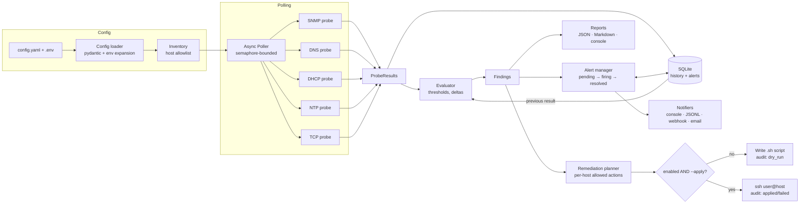

# NetWarden

NetWarden is a Python network health monitor. It polls the hosts you list in its config over
**SNMP**, checks **DNS** answers and **DHCP** pool and server health, measures **NTP** clock drift,
and probes **TCP** service ports. It grades each result against thresholds, raises alerts only
after repeated failures, writes JSON and Markdown health reports, and can generate
**remediation scripts**. Those scripts only run if you opt in, and dry run is the default.

## Features

| Area | What it checks |
|------|----------------|
| SNMP (v2c / v3) | sysUpTime (spots reboots), CPU load (HOST-RESOURCES-MIB), interface admin/oper status, new interface errors since the last poll |
| DNS | Asks the host directly for configured records, compares the answers to what you expect, and times the response |
| DHCP | Pool utilisation read from ISC `dhcpd.leases` or dnsmasq lease files. Can also send a DHCPDISCOVER and wait for an OFFER (optional) |
| NTP | Clock offset, delay, stratum, and leap/unsynchronised detection |
| TCP | Whether each port is open, and how long the connection takes |
| Alerting | Flap suppression (N failures in a row), escalation, reminders, recovery notices. Sends to the console, a JSONL file, a webhook (Slack-compatible) or email |
| Reports | JSON plus Markdown in `reports/` (`latest.json`, `latest.md`), and Rich console tables |
| Remediation | Restart a service, flush the DNS cache, step the clock via chrony/ntpd, bounce an interface, restart snmpd. Delivered as reviewable `.sh` scripts, with an audit log |

### Safety model

- **Only hosts in the inventory.** NetWarden never scans or discovers anything. Each host must be
  a single address or hostname; CIDR ranges are rejected. The poller and the remediation executor
  check every target against the inventory again before touching it.
- **Remediation is opt-in at three levels.** It runs only when `remediation.enabled: true` is
  set, the action is in that host's `allowed_actions`, **and** you pass
  `netwarden remediate --apply`. Otherwise NetWarden writes the script to `remediation_scripts/`
  for you to review and logs a `dry_run` entry in the audit log.
- **No shell injection through parameters.** Service and interface names must come from the
  host's own `services` / `interfaces` allowlist. They are checked against a strict pattern and
  shell-quoted. SSH runs through `exec`, not a local shell.
- **Secrets stay in environment variables.** The config refers to them as `${VAR}`; see `.env.example`.

## Architecture



### Code layout

```
src/netwarden/
├── config.py          # pydantic config models, ${ENV} expansion, validation
├── inventory.py       # host allowlist; TargetNotAllowed
├── models.py          # ProbeResult, Finding, Severity, PollCycle
├── probes/            # snmp.py, dns.py, dhcp.py, ntp.py, tcp.py + base/registry
├── poller.py          # concurrent probe execution
├── evaluator.py       # threshold rules -> findings
├── state.py           # SQLite history and alert state
├── alerts.py          # alert lifecycle and de-duplication
├── notifiers.py       # console / jsonl / webhook / email
├── reports.py         # JSON, Markdown and console reports
├── remediation/       # actions.py (catalogue), planner.py, executor.py
├── runner.py          # poll cycle + daemon loop
└── cli.py             # Typer CLI
deploy/netwarden.service  # hardened systemd unit
```

## How to run

Requirements: Python 3.11+ on Linux or macOS. You need network access to the monitored hosts
(UDP 161 for SNMP, UDP/TCP 53 for DNS, UDP 123 for NTP, and whatever TCP ports you configure), and
SNMP enabled on each device you want to poll.

```bash
python -m venv .venv && source .venv/bin/activate
pip install -e ".[dev]"

cp config.example.yaml config.yaml   # edit hosts, checks, thresholds
cp .env.example .env                 # fill in SNMP community / v3 keys, webhook URL, ...

netwarden validate-config            # parse and validate config
netwarden hosts                      # show the monitored inventory
netwarden check                      # one poll cycle; exit code 0 ok / 1 warning / 2 critical
netwarden check -t dns -o markdown   # only hosts tagged "dns", Markdown output
netwarden check --plan-remediation   # also generate dry-run remediation scripts
netwarden run                        # poll every polling.interval_seconds until Ctrl-C
netwarden report -o json             # re-render the latest stored results
netwarden remediate                  # dry run: write scripts + audit entries
netwarden remediate --apply          # execute (needs remediation.enabled: true)
```

`--config` defaults to `./config.yaml`. You can also set it with `NETWARDEN_CONFIG`.

### Running as a service

```bash
sudo cp deploy/netwarden.service /etc/systemd/system/
sudo systemctl daemon-reload && sudo systemctl enable --now netwarden
```

### Notes and prerequisites

- **DHCP lease checks** read the lease file locally. Run NetWarden on the DHCP server, or sync
  the file to the NetWarden host.
- **Active DHCP probe** (`active_probe: true`) binds UDP/68 and broadcasts a DISCOVER. It needs
  root or `CAP_NET_BIND_SERVICE`, and it only accepts OFFERs from the configured server.
- **Remediation over SSH** needs key-based, non-interactive SSH (`BatchMode=yes`) to the target
  as `ssh_user`, plus passwordless `sudo` for the specific commands (`systemctl restart <svc>`,
  `chronyc makestep`, `rndc flush`, `ip link set`). The generated scripts list the exact commands.
- **NTP offset** is measured relative to the clock of the machine running NetWarden. Keep that
  machine well synchronised.

## How to test

The unit tests make no network calls. Probes are faked, and the DHCP packet builder, lease
parsers, evaluator, alert lifecycle, remediation planner/executor (with `ssh` stubbed) and report
rendering are tested directly.

```bash
pip install -e ".[dev]"
pytest -q
ruff check src tests
```

To try it against real devices, point a `config.yaml` at a lab switch or a Linux box running
`snmpd`, `named`/`unbound` and `chrony`, then run `netwarden check -v`.
